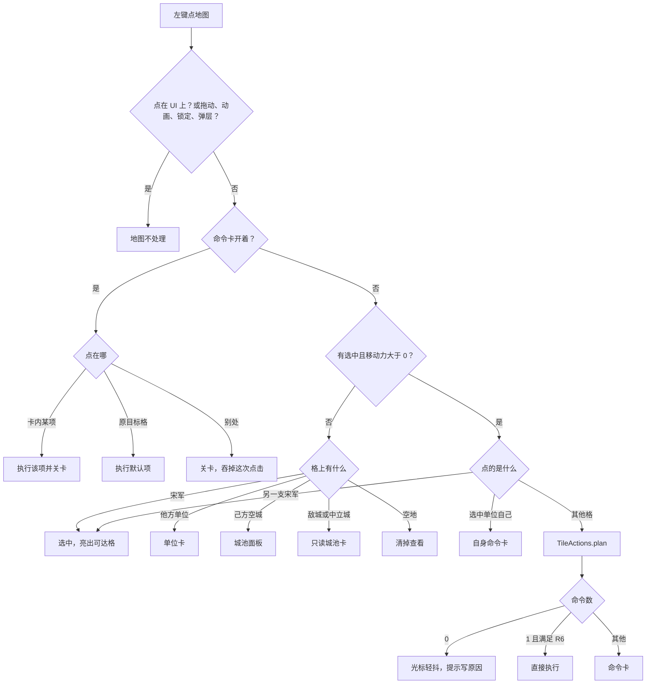

# 地块交互方案 v1：悬停样式与点击命令卡

> 2026-10-23 · 交互策划 · 依据：John 的两条需求（悬停分样式；右键改为点击后弹菜单）、《设计文档.md》GDD v0.2 §5、§10、§16、`ui/style_guide.md`、《格物图UX重做.md》的写法。
> 代码核对基准：GitHub `jicaixin/song-ai-game` main `93d2cf5`（2026-10-23 12:04 UTC+8，“Keep the opening guide from swallowing the highlighted hex”）。工作区 `handoff/bundle` 里那份是旧的 `b1f2ed2`，还没有 Home、「回延州」和开局引导，以 GitHub 为准。文中行号都指 `93d2cf5`。
> 本方案只改地图上的输入、悬停和命令呈现，不改规则和数值。标「M2」「M3」的项依赖 GDD 里程碑中还没做的系统（迷雾、多回合行军、占城、休整、民夫），系统没上线之前**不显示**。

## 0. 现状核对（从代码确认）

| # | 现状 | 代码位置 | 对本方案的影响 |
|---|---|---|---|
| 1 | 左键：点宋军就选中；点他方单位只查看（`inspected_uid`）；点空地取消选中，点到城就开城池面板 | `scripts/view/world_map.gd` `_left_click()` L1532 | 选中逻辑保留；“点空地取消选中”改掉，见 §3 |
| 2 | 右键：如果点的是敌军，走 `_try_attack()`；如果是 `reach_cost` 里的格，走 `_move_to()`。别的情况没有反应，也没有提示 | `_right_click()` L1555 | 改成“快捷执行默认动作”，见 §5 |
| 3 | `_try_attack()` 打不到时，会**先自动走到**最近的可攻击格，再弹预览。玩家还没确认，移动力就已经花掉了 | L1570–1598 | 改成菜单项「移动并攻击」，确认后才动，见 §4 |
| 4 | 中键点一下不拖，等于右键；按住拖动是平移地图 | `_unhandled_input()` L1349，`order_press/order_moved` | 保留，跟右键一致 |
| 5 | 战斗预览是模态面板「接战」（720×340，位置 280,160），按钮是「开战」「取消」 | `scripts/ui/game_ui.gd` `_build_combat()` L301、`show_combat()` L545 | 降级为「战斗明细」，见 §4.3 |
| 6 | 高亮叠层：可达格绿填充 `Color(0.25,0.72,0.48,0.42)`；选中单位金边 `#F0D060`，宽 0.28；射程内敌军朱边 `#C44A3A`，宽 0.26；悬停白边 0.85 α，宽 0.16；引导格金填 35% 加 `#E7C98A` 粗边；屏幕中心格淡描 | `_refresh_overlay()` L1643 | 颜色沿用；补上形状和图标区分 |
| 7 | `_refresh_overlay()` 每次都重建整张 SurfaceTool 网格，还**新建一个 StandardMaterial3D**。悬停换格、镜头中心换格（`_sync_center_hex()`）都会触发 | L1643–1682、L1222 | 性能要拆层，见 §8.4 |
| 8 | 悬停提示是左下角固定的一行字 `hover_chip`，位置 (16,548)，520×28，无延迟。内容只有“地形 · 势力 · 城名” | `game_ui.gd` `_build_hover()` L195、`_refresh_hover()` L504 | 改成跟随光标的两级提示，见 §2.3 |
| 9 | `blocks_pointer()` 把 `hover_chip` 的矩形也算作 UI，所以左下角这条下面的地图点不到 | `game_ui.gd` L594 | 新提示必须 `MOUSE_FILTER_IGNORE`，不能挡点击 |
| 10 | 可达只算本回合（`Pathfinder.reachable` 预算是当前移动力，雪天 −1），有控制区（进入敌军相邻格必须停下）。没有多回合路径 | `scripts/core/pathfinder.gd` | 多回合格先不画“N 回合”，见 §2 |
| 11 | F 驻扎只做一件事：把移动力清零（`GameState.fortify()`），**没有防御加成** | `scripts/autoload/game_state.gd` L288 | 菜单文案不能写“防御 +” |
| 12 | 远程单位只要在射程内（含相邻）一律按远程结算，攻方不受反击。弓手射程 2 | `scripts/core/combat_resolver.gd` `assess()` | 弓手只出「远程攻击」，不出近战 |
| 13 | 没有迷雾、补给、占领、民夫。`units.json` 里宋军只有厢军、枪盾手、弓手、骑军、斥候五种 | HANDOFF「刻意未做」、`data/units.json` | 相关菜单项标 M2/M3 |
| 14 | 敌对关系写死：宋对夏、宋对辽为敌；唃厮啰、大理等不敌对 | `scripts/autoload/data_db.gd` `hostile()` | 辽军按敌军样式显示 |
| 15 | 开局引导共 5 步。第 2 步原文：“右键点这一格亮着的地方。绿格子是今天还走得动的路。”部队位置一变就进下一步。引导期间只有镂空洞口（加上引导格周围 72px）里的点击能穿透 | `scripts/ui/onboarding.gd` `LINES` L5、`_check()` L202、`_input()` L297 | 改写见 §6 |
| 16 | 开场台词 `boot` 和闲聊 `hold` 都在教右键 | `data/dialogue/doushabao.json` L3、L33 | 一起改 |
| 17 | 地图热键已经占用：WASD 和方向键、T P J I L Y H E R、M、F、空格、回车、Home、F5、F9、?、Esc | `world_map.gd` `_key()` L1409 | 新快捷键只用 Q C V Z Tab Shift 和数字键 |
| 18 | 格物图节点上右键是打开史册页，这和地图无关 | `scripts/ui/tech_desk.gd` L1320 | 不动 |
| 19 | 字体子集没有 ⚡ ▾ ▸ ⋯，⚔ ⊘ 一类符号也不能保证有 | HANDOFF「字体与主题」 | 游戏里所有符号都用图标贴图。本文表格里的符号只是给人看的说明 |

## 1. 设计目标与原则

1. **悬停说什么，点击就做什么。** 悬停和点击调用同一个纯函数 `TileActions.plan()`，所以预告和结果不会对不上。
2. **所见即所得才一点即成。** 只有一个命令、结果就落在所点的那一格、而且悬停已经预告过消耗时，单击直接执行。其余情况弹命令卡。
3. **对敌动作一定要确认。** 攻击、占领这类不可逆的对敌动作，哪怕只有一个选项，也要弹卡片，卡片里直接附上预计战果。
4. **三重编码。** 每种状态都有一个**边框形状**、一个**格心角标或光标图标**、一个**提示首行动词**。颜色只做辅助，灰度截图也分得出来。
5. **不做的事不画。** 系统没上线的命令直接隐藏，不灰显。灰显只留给“这个情境下本来能做、眼下条件不够”的命令，并写明原因。
6. **零新增点击。** 常见操作（选人、走路）的点击次数不多于现在；攻击仍然是两次点击（点敌军 → 点「攻击」），和现在的“右键 → 开战”一样。

## 2. 悬停样式

### 2.1 叠放优先级

一个格可能同时符合好几种状态，比如“敌军站在城里，旁边有河”。规则如下：
- **边框和光标**取交互优先级最高的那一项：引导格 > 攻击目标 > 本回合可达 > 需多回合 > 不可达或不可通行 > 城池或势力 > 默认。
- **提示首行**取内容优先级最高的那一项：单位 > 城池 > 关隘 > 资源 > 地形。
- **角标**最多叠两个：交互角标放格心，资源或关隘角标放右上。
- 选中单位脚下的金边、射程内敌军的朱边属于常驻层，悬停时**加粗**，不替换。

### 2.2 样式分类表

“无选中”指没有选中宋军，或者选中的宋军移动力已经是 0；“有选中”指选中了还能动的宋军。颜色键名见 `ui/style_guide.md`。描边宽度用世界单位，沿用 `_stroke_hex()` 的 width 参数；z0 远景只画边框和光标，不画角标。

| # | 状态 | 边框 / 填充（形状） | 颜色 | 格心角标（16×16 图标） | 光标 | 提示首行（150ms 后） | 展开内容（停 600ms 或按住 Shift） |
|---|---|---|---|---|---|---|---|
| 1 | 空地，无选中 | 实线细描，宽 0.16，无填充（同现状） | 白 α0.85 | 无 | 默认（C01） | `平原 · 宋 · 鄜延路` | 移动消耗 1、防御 +0、产出 粮2 钱1；有河时加一行“东侧临河：渡河攻击 −3” |
| 2 | 本回合可达，有选中 | 已有绿填充；悬停格改成**白实线粗描**，宽 0.24；从单位到该格画路径虚线，终点放一块“剩 N”牌 | 填充 `lv` 绿 α0.42（现色）；路径线 `paper0` | 脚印（B03） | 靴（C03） | `移动 · 花 2 步，剩 0` | 路径经过的地形逐格列出；终点贴敌时加一行“进入敌军控制区，到达后停下”；终点是城时加“进入延州” |
| 3 | 需多回合，有选中（**M2**） | 无填充，**长虚线**描边，宽 0.20 | `paper0` α0.7 | 回合牌“2回”（B06） | 靴加沙漏（C04） | `行军 · 约 2 回合` | 每回合的落脚格；第一回合落脚格画实心小点 |
| 3' | 本回合走不到（现在版本） | 同 3，但不显示回合牌 | 同 3 | 脚印加箭头（B03b） | 靴加沙漏（C04） | `本月走不到 · 可先走到最近处` | “最近可达格：(17,27)，花 2 步”；点击后弹菜单，见 §3 |
| 4 | 不可达（可通行，但被控制区或别的部队挡住），有选中 | **点线**描边，宽 0.16，无填充 | `ink4` `#A39482` | 禁止（B05） | 禁止（C07） | `去不了 · 被敌军控制区挡住` | 原因只写一条：控制区 / 格上已有部队 / 移动力不够 |
| 5 | 不可通行地形（高山、湖泊、海洋） | 无选中时同 1；有选中时同 4，并加 45° 细斜纹 | 同 4 | 禁止（B05） | 无选中：默认；有选中：禁止 | `湖泊 · 不可通行` | 湖海写“需船只（未开放）” |
| 6 | 己方城（宋） | **城垛描边**（边上每隔一段外凸一个小方齿），宽 0.22 | 朱 `#C23B2A` 加金 `#E3B341` 内线 | 城（B09） | 无选中：城门（C09）；有选中且可达：靴（C03） | `延州 · 驻军 1/2` | 人口、城墙 +8、驻军 n/N（军 1、州 2、府 3、京 3）、本月产出；有选中时加“进城：按地形，延州 2 步” |
| 7 | 敌城（夏、辽） | 城垛描边，**齿朝内** | 势力主色：夏 `#6B3E8E`、辽 `#24467F`，外沿朱细线 | 敌城（B10） | 无选中：放大镜（C08）；城里有可攻击的敌军时：剑（C05） | `夏州 · 西夏 · 城墙 +8` | 城防、守军（看得到时）；M3 上线后再加占城条件 |
| 8 | 中立或其他势力（唃厮啰、大理、高丽等）的地块和城 | **点划线**描边，宽 0.16 | 势力主色，α0.8 | 旗（B11） | 默认；有选中且可达：靴 | `青唐 · 唃厮啰 · 友好` | 外交态度（取外交页数据）；有选中时加“进入他国境内”提醒，不拦着 |
| 9 | 敌军，可攻击（在射程内且有移动力） | 已有朱边加粗到 0.32，再加**内侧斜纹填充** | 朱 `#C44A3A`，斜纹 α0.25 | 近战：剑（B01）；远程：箭靶（B02） | 剑（C05）/ 准星（C06） | `攻击 铁鹞子 · 敌 −22~33 / 我 −18~27` | `CombatResolver.assess()` 的修正明细（`format_parts`），包括地形、城墙、渡河、侧翼、将领、伤势；远程写“攻方不受反击” |
| 9b | 敌军，要先移动才打得到 | 朱**实线**，宽 0.24，无斜纹；预览落脚格画路径虚线 | 朱 | 靴加剑（B01b） | 剑（C05） | `移动并攻击 · 先走到 (16,26)` | 按落脚格算出的预计战果（用临时坐标调 `assess()`），以及移动消耗 |
| 10 | 敌军，打不到（超出射程、没有移动力，或者没有选中） | 朱**短虚线**，宽 0.16 | 朱 α0.7 | 眼（B14） | 放大镜（C08） | `铁鹞子 · 西夏 · 生命 100` | 兵种、战力、特性（如“冲锋 +4，对弓手 +5”）、将领；有选中时加打不到的原因：“相距 3，射程 2”或“移动力已用完” |
| 11 | 己方单位，还能动 | **双线**描边（外 0.12 加内 0.08，间隔 0.10） | 金 `gold_l` `#E8CB7C` | 无（单位旗已经够显眼） | 手（C02） | `刘平部 · 禁军枪盾手 · 移动 2/2` | 生命、将领、特性（“对骑兵 +5”） |
| 12 | 己方单位，已行动（移动力 0） | 单线细描，宽 0.10，单位模型压暗 35%，并画 ✓ | 金 α0.5 | 已动（B04，✓ 形） | 手（C02） | `延州守军 · 本月已行动` | 同 11 |
| 13 | 河（格边有河） | 默认描边之外，把**有河的那几条边**加粗高亮，宽 0.30 | 天青 `#9FC3B8` | 水波（B12），右上 | 跟随所在格状态 | 首行在地形名后加 `· 临河` | “渡河攻击 −3 / 渡大河 −6；大河暂不挡路”（照实写，现在只扣战力） |
| 14 | 山地、丘陵、黄土塬、森林、沼泽、荒漠、沙漠 | 跟随所在格状态，地形本身**不改边框** | — | 无 | 跟随 | `山地 · 移动 3 · 防 +5` | 移动消耗用 1–3 个实心圆点表示；步跋子一类特性要单独注明：“步跋子走这里只算 1” |
| 15 | 战争迷雾：未探索（**M2**） | **点线**描边，加淡米色填充 α0.25 | `paper3` `#D8C59C` | 问号（B07） | 默认；有选中：靴加沙漏 | `未探明` | “路况不明，按 1 步估”；不显示势力和单位 |
| 15b | 战争迷雾：探索过但当前看不到（**M2**） | 同 1 | 同 1 | 无 | 同所在状态 | `平原 · 宋 · 上次所见 T12` | 只显示上次看到的城和地形，不显示单位 |
| 16 | 有资源的格（茶、丝、马、铜、铁、盐、硝、煤） | 不改边框 | — | 右上**金菱角标**加资源图标（复用 `res_*` 缩到 16） | 跟随 | 首行末尾加 `· 铜` | “铜：信州铅山场；需建胆铜场（百工图 >）” |
| 17 | 关隘（`feature.id == pass`） | 不改边框 | — | 右上“关”字印（B13） | 跟随 | `金锁关 · 关隘` | 关隘说明（数值还没做，只写名字和史实一句） |
| 18 | 引导格（教学用） | 现状不变：金填 35% 加 `#E7C98A` 粗边 0.42；再加呼吸光（α 0.6↔1，1.2 秒一周期） | 金 | 指引箭头（B15） | 跟随 | 跟随所在格 | 同所在格 |

**色盲核对**：红绿色弱最容易混的是 2（绿）和 9（朱）。两者的形状不同（白实线加路径 / 朱边加斜纹），光标不同（靴 / 剑），首行动词也不同（移动 / 攻击）。辽的深蓝和夏的紫在蓝黄色弱下接近，所以敌城一律加“敌城”角标，提示首行写势力名。效果图要出灰度和色弱模拟两版来验收，见 §7。

### 2.3 提示框规格

| 项 | 规格 |
|---|---|
| 位置 | 跟随光标，右下偏移 (+18, +22)。碰到屏幕右边或下边就翻到左侧或上侧。距屏幕边至少 16px；不盖住顶栏（y<52 的区域）和右下坞（1020,450 起） |
| 外观 | 复用 `tooltip` 9-slice 的黛青变体（`panel_ink` 色）。首行 HudLabel 15px，`paper1` 色；展开行 Small 13px，`tianqing_l` 色；最宽 300px |
| 首行 | 一行，格式固定为 `[动词或名称] · [关键数字]`。有选中时，首行必须以动词开头（移动、攻击、去不了……） |
| 延迟 | 边框和光标与换格**同一帧**生效；首行 **150ms**；展开 **600ms**（停住不动），或按住 Shift 立即展开 |
| 热切换 | 提示已经显示时，300ms 内移到相邻格，内容直接换掉，不再等 150ms，避免一路闪烁 |
| 隐藏 | 中键拖动、WASD 平移、缩放动画、移动动画、`input_locked`（西夏行动中）、任何弹层打开时都隐藏；命令卡打开时也隐藏，卡片自己就是提示 |
| 鼠标 | `MOUSE_FILTER_IGNORE`，从 `blocks_pointer()` 里移除（现在的 `hover_chip` 会挡点击） |
| 左下旧条 | 删除 `hover_chip`。`key_hint`（“空格 下一支可动宋军 · Home 回延州”）保留，并补上“Shift 看明细” |

## 3. 点击流程

### 3.1 判定规则（按顺序判，命中一条就停）

| # | 条件 | 结果 | 例子 |
|---|---|---|---|
| R0 | 点在 UI 上，或者处于拖动、动画、`input_locked`、弹层打开的状态 | 地图不处理 | — |
| R1 | 命令卡开着 | 点到卡内就执行该项；点到原目标格（相当于双击）就执行默认项；点到别处只关卡，**这次点击被吞掉**，不触发地图动作 | — |
| R2 | 没有可动的选中单位 | **只查看，直接生效**：点宋军就选中；点他方单位就开单位卡；点己方空城就开城池面板；点敌城或中立城就开只读城池卡；点空地就清掉查看状态 | 点延州守军 → 选中，绿格亮起 |
| R3 | 有选中，点的是另一支宋军 | 直接切换选中 | 刘平部 → 石元孙部 |
| R4 | 有选中，点的是选中单位自己 | 弹**自身命令卡** | 驻扎、待命、打开城池、取消选择 |
| R5 | 有选中，按 `TileActions.plan()` 算出的命令类动作是 0 个 | 不执行；光标轻抖 120ms，提示首行显示原因 | 点湖泊 → “湖泊 · 不可通行” |
| R6 | 命令类动作只有 1 个，**并且**：结果就落在所点的格、不是对敌动作、不花电或钱、悬停已经预告过 | **直接执行** | 点绿格 → 走过去 |
| R7 | 其他情况：2 个以上命令，或者有对敌动作，或者结果不在所点的格（走到最近处、行军），或者要花电 | 弹**命令卡** | 点敌军、点本月走不到的格、点可达的己方城 |

“命令类”指会改变局面的动作。「查看详情」「打开城池」「取消」不算命令，不参与 R5–R7 的计数。

### 3.2 各类目标的结果（有选中、且还能动）

| 点击目标 | 现在 | 新方案 | 点击次数（现在 → 新） |
|---|---|---|---|
| 空地，本回合可达 | 左键：取消选中；右键：移动 | 左键直接移动（R6） | 1 → 1 |
| 空地，本回合走不到 | 左键：取消选中；右键：没反应 | 命令卡：走到最近处 / 取消选择 / 取消 | 无 → 2 |
| 空地，不可达或不可通行 | 左键：取消选中 | 不执行，显示原因（R5）。取消选中改用 Esc 或单位卡上的 × | — |
| 己方城，可达且城里没人 | 左键：开城池；右键：移动 | 命令卡：进城 / 打开城池 / 取消 | 1 → 2（多出来的一次换来两件事都能做） |
| 己方城，城里已有宋军 | 左键：选中那支宋军 | 命令卡：入城驻防 / 选中守军 / 打开城池。城未满才能入城，步数按地形算（延州黄土 2 步）。满员写“已满 n/n”。城牌右侧画「驻 n/N」，满员改朱底；每支宋军的步数珠在徽标下各排一行，人站在朝向镜头的城墙外 | 1 → 2 |
| 敌军，在射程内 | 右键 → 预览 → 开战 | 命令卡（附预计战果）：攻击 / 战前推演 / 战斗明细 / 取消 → 点「攻击」立即开战 | 2 → 2 |
| 敌军，要先走几步才打得到 | 右键 → **自动先走** → 预览 → 开战 | 命令卡：移动并攻击（显示落脚格和按落脚格算的战果）/ 只走到旁边 / 取消 | 2 → 2，而且走之前就能反悔 |
| 敌军，打不到 | 右键：没反应 | 单位卡，加一行“打不到：相距 3，射程 2” | — |
| 敌城 | 左键：开城池（敌城也开） | 城里有可攻击的敌军时同“敌军”；城是空的就弹命令卡：走到城下 / 查看城池（占领见 M3） | — |
| 中立势力的格 | 同空地 | 同空地，提示多一行“进入他国境内” | — |
| 迷雾格（M2） | 无 | 本回合可达：直接移动；走不到：同“走不到”，菜单项改为「设为行军目标」 | — |
| 选中单位自己 | 无 | 自身命令卡 | 无 → 2 |

**选中的宋军已经没有移动力**时，点击一律按 R2 的“只查看”处理，选中状态保留，方便看信息。

### 3.3 流程图



### 3.4 输入状态表

| 状态 | 进入 | 左键 | 右键 / 中键点击 | Esc | 离开 |
|---|---|---|---|---|---|
| 浏览 BROWSE | 开局、取消选中、选中单位移动力归零 | R2 | 无动作 | 关查看 | 选中宋军 |
| 命令 COMMAND | 选中能动的宋军 | R3–R7 | 快捷执行默认动作（§5） | 取消选中（现有行为） | Esc、移动力归零、回合结束 |
| 菜单 MENU | 触发 R4 或 R7 | R1 | 关卡 | 关卡，选中保留 | 执行、关闭（§4.5） |
| 明细 DETAIL | 卡里点「战斗明细」 | 面板按钮 | 关面板，回到菜单 | 同右键 | 开战 / 取消 |
| 动画 ANIM | `_move_to` / `animate_strike` 播放中（`suspend>0`） | 忽略 | 忽略 | 忽略 | 动画结束 |
| 锁定 LOCKED | `GameState.input_locked`（西夏行动中） | 忽略（悬停照常） | 忽略 | 忽略 | 解锁 |
| 弹层 MODAL | `desk` 或 `combat_panel` 打开 | 交给 UI | 交给 UI | 关弹层 | 关闭 |
| 引导 TUTOR | `onboarding.active`（叠在上面几种状态之上） | 只有洞口里的点击能穿透（现有） | 同左键 | 不响应（引导用「跳过」按钮） | 完成或跳过 |

## 4. 命令卡

### 4.1 形式：卡片式（不用环形）

| 比较项 | 卡片式（采用） | 环形 |
|---|---|---|
| 中文标签 | 一行能放下“移动并攻击 2”和灰显原因 | 扇区窄，4 个字以上就得缩字或只放图标，跟“一目了然”的要求相反 |
| 选项数会变（2–7 项） | 竖排，加一项就多一行，排版稳定 | 6 项以上扇区太挤；数量一变，每项的方位也跟着变，方位记忆就没了 |
| 遮挡 | 整张卡放在目标格一侧，不盖目标格，也不盖周围的格 | 以格为圆心铺开，正好盖住相邻的 6 格，而那些格往往就是玩家要比较的落脚格和敌军 |
| 预计战果 | 卡头能放两行战果和伤害条，把旧的「接战」模态窗合并进来 | 只能另开浮窗，又多一层 |
| 键盘 | 数字键对应行号，上下键移动焦点，Enter 执行，天然支持 | 要另外定义方位键 |
| 屏幕边缘 | 翻到左侧或上方就行 | 靠边的格只能放半个圆，或者得挪镜头 |
| 和现有套件 | 直接用 `panel_ink`、`list_item_*`、`tooltip` 9-slice，以及 HUD 的黛青浮层风格（单位卡、战斗预览同一套） | 套件里只有 44px 的 `btn_round`，扇区底板要新画 |
| 环形的优点 | — | 手势快，适合实时游戏。本作是回合制，不追求毫秒级操作 |

### 4.2 外观与尺寸（1280×720 逻辑像素）

```
           ┌─────────────────────────────┐
  目标格 ◇─┤ [夏] 铁鹞子 · 平原 · 生命100│ 卡头 32
           │ 预计  敌 −22~33  ████░░     │ 战果区 52（只在对敌卡出现）
           │       我 −18~27  ███░░░     │
           ├─────────────────────────────┤
           │1 [剑] 攻击            Enter│ ← 默认项：左侧 3px 金条加焦点底
           │2 [推演] 战前推演   电4      │ 青蓝字（电相关）
           │3 [盾] 驻扎                  │
           │   本月已攻击过，不能驻扎    │ ← 灰显：第二行写原因，12px
           │  [明细] 战斗明细          V │
           │  [×]   取消             Esc │
           └─────────────────────────────┘
             宽 232 · 每行 36（灰显带原因的行 48）
```

| 部件 | 规格 |
|---|---|
| 底板 | `panel_ink` 9-slice（黛青 `#1B2B2C`，外沿鎏金 1px `gold`）；阴影 0,3,8，α0.35 |
| 卡头 | 势力徽记 20×20（`emblem_*` 缩放）加名称（H3 16px，`paper1` 色）加一行状态（Small 13px，`tianqing_l` 色） |
| 战果区 | 两行：数字（Number 16px）加 64×8 伤害条（`bar_fill_hp_*`）；对方先列，我方后列；我方预计损失大于对方时，在下方加一行 `warn` 色小字“预计不利” |
| 行 | 左边行号 12px（`ink4` 色）→ 图标 24×24 → 文字 Button 16px → 右对齐的快捷键帽（18×18 `keycap`）或花费胶囊（`pill_dian` 等） |
| 引线 | 从卡片靠近目标格的一边中点，连一条 1px `gold` 细线到格心；目标格同时显示该状态的悬停边框 |
| 动画 | 出现：0.08 秒，透明度 0→1，缩放 0.96→1；关闭不放动画，立即消失 |

### 4.3 菜单项清单

“版本”一列：**现**表示用现有代码就能做；**小**表示要加一个小字段或小函数；**M2/M3** 表示等系统上线前隐藏。

| 排序 | 菜单项 | 图标 | 出现条件（满足才显示） | 可用条件（不满足就灰显） | 灰显原因示例 | 快捷键 | 执行 | 版本 |
|---|---|---|---|---|---|---|---|---|
| 1 | 攻击 / 远程攻击 | A02 / A03 | 目标格有敌军 | 在射程内；移动力 > 0 | “移动力已用完”“相距 3，射程 2” | 数字、Enter | `GameState.resolve_attack()` 加 `animate_strike`（等于原来的「开战」） | 现 |
| 2 | 移动并攻击 | A04 | 目标格有敌军，且当前位置打不到 | 存在可达的落脚格，且到那里后还剩移动力 | “走不到能出手的位置（被控制区挡住）” | 数字 | 走到落脚格，然后**直接攻击**。卡上已经给出按落脚格算的战果，不再弹第二次确认 | 现（拆 `_try_attack`） |
| 3 | 战前推演 | A11（青蓝） | 目标格有敌军，且豆沙包没有休眠 | 电量够（GDD §10.4：4–6 电） | “电量不足：需 4，剩 2” | 数字 | 扣电，战果区换成精确分布，本次攻击战力 +3 | M2（GDD 已有，代码还没有） |
| 4 | 移动 / 入城驻防 | A01 / A07 | 目标格本回合可达（只在菜单里出现，比如可达的己方城；普通可达格走 R6 直接执行） | 进城：己方城未满（军 1、州 2、府 3、京 3），步数够付地形 | “延州已满 2/2 · 先让一支出城”“要 2 步，只剩 1 步（雪天 −1）” | 数字 | `_move_to()` | 现 |
| 5 | 走到最近处 | A01b | 目标格本回合走不到，但路上有可达格 | 至少能走 1 格 | “本月一步也走不动” | 数字 | 走到路径上最远的可达格 | 小（在 `reach_cost` 里挑离目标最近的格） |
| 5' | 设为行军目标 | A12 | 同上 | 有路线 | “无路可通” | 数字 | 存下目标格，每回合自动走 | M2 |
| 6 | 占领 | A15 | 目标格是敌城，且城里没有敌军 | 近战单位；城防已经归零 | “城防未破（8）”“远程部队不能占城” | 数字 | 占城 | M3 |
| 7 | 修筑堡寨 | A14 | 点的是选中单位自己，且单位是厢军或民夫 | 已完成格物 M02；钱和匠够 | “需格物「堡寨筑城法」” | B | 修堡寨 | M3 |
| 8 | 驻扎 | A05 | 点的是选中单位自己 | 移动力 > 0 | “本月已行动” | F（现有） | `GameState.fortify()`：移动力清零。提示只写“本月不再行动”，**不写防御加成** | 现 |
| 9 | 待命（本月跳过） | A06 | 点的是选中单位自己 | 移动力 > 0 | 同上 | Q | 标记 `skip_turn`，移动力保留；空格切换时跳过它，「结束回合」也不再提醒它 | 小 |
| 10 | 休整 | A13 | 点的是选中单位自己，且生命 < 100 | 不贴着敌军 | “敌军在侧，无法休整” | 数字 | 每回合回血，直到满 | M3 |
| 11 | 撤回移动 | A16 | 点的是选中单位自己，且它本回合刚走过 | 走完之后没有发生战斗，也没有出现新信息 | “已交战，不能撤回” | Ctrl+Z | 退回原格，返还移动力 | 小（见 §9 Q2） |
| 12 | 打开城池 | A08 | 目标格是己方城（或者选中单位站在己方城里） | — | — | C | `game_ui.open_city()` | 现 |
| 13 | 查看详情 / 战斗明细 | A09 | 总是出现；对敌卡里叫「战斗明细」 | — | — | V | 单位卡加展开；对敌卡打开原 `combat_panel`（「开战」「取消」保留） | 现 |
| 14 | 取消选择 | A10b | 点的是选中单位自己，或者是“走不到”的卡 | — | — | — | `selected_uid = -1` | 现 |
| 15 | 取消 | A10 | 总是出现，固定在最后一行 | — | — | Esc、右键 | 关卡 | 现 |

**GDD 对照**：「劫掠」在 GDD 里只给部族骑兵（西夏）和山贼，宋军没有，所以不加。“建改良”属于民夫（GDD §7.4），而 `units.json` 里还没有民夫，跟「修筑堡寨」一起放到 M3。

**排序与编号**
- 行的顺序按上表“排序”列固定：先对敌，再移动，再自身动作，最后信息和取消。灰显的行**留在原位**，所以同一种卡里，数字键对应的项不会变。
- 默认项是第一条可用的命令，打开时就有焦点，Enter 或双击目标格就执行。默认项不会是战前推演（要花电）。
- 数字键只编给命令类行（排序 1–11），信息行和取消用字母键或 Esc。

**灰显样式**：图标去色，α0.4；文字改 `ink4` `#A39482`；行下方第二行用 Caption 12px 写原因，常驻显示，不用悬停才看到；原因是缺科技时，前面加一个 12px 的 `ui_lock`。灰显行可以悬停（底色变 `dai2`），点击不执行，只把原因行闪一下。

### 4.4 位置

1. 算出目标格中心的屏幕坐标 P = `world_to_screen()`，以及格半径 R（P 到格右顶点的距离）。各档参考值：z2 约 105px，z1 约 42px，z0 约 15px。
2. 按顺序试四个位置：**右**（卡片左边 = P.x + R + 12，卡头顶部和 P.y − 24 对齐）→ **左** → **下** → **上**。
3. 安全区是 (16, 60)–(1264, 704)。尽量避开右下坞（1020,450–1280,720）、单位卡（16,188,300×132）和豆沙包卷轴；实在避不开可以盖住这些 HUD，因为卡片层级比 HUD 高。
4. 卡片**绝不能盖住目标格的外接矩形（P ± R，再外扩 8px）**；有选中单位时，也尽量不盖它所在的格。
5. 四个位置都放不下时（只会出现在 z2 下贴屏幕角的格），镜头用 `focus_smooth()` 平移 0.2 秒，把目标格拉向屏幕中心，卡片跟着走。这次镜头移动不算关闭条件。
6. 首选右侧，是因为大多数情况下鼠标刚好停在格心偏右，第一行离光标不到 60px。

### 4.5 关闭规则

| 触发 | 结果 |
|---|---|
| 执行任意一项 | 关闭 |
| Esc | 关闭，选中保留；再按一次 Esc 才取消选中（现有逻辑） |
| 右键或中键点任意位置 | 关闭，不执行 |
| 左键点在卡片和目标格之外 | 关闭，并**吞掉这次点击** |
| 左键再点目标格 | 执行默认项，然后关闭 |
| 镜头移动：拖动、WASD、滚轮、小地图、Home、空格、M | 关闭（例外：§4.4 第 5 条里卡片自己触发的平移） |
| 回合结束、`input_locked`、任何弹层打开（T P J … 或 `combat_panel`） | 关闭 |
| 目标失效：目标单位死亡或移走、选中单位没了 | 关闭 |
| 引导换步 | 关闭 |
| 不会关闭的情况 | 鼠标移出卡片、停留时间长短（不设超时） |

## 5. 右键的去留

**建议：保留右键，作为老玩家的“快捷默认动作”；命令卡开着时，右键表示“关闭”。** 理由：现有的 Civ 式习惯（以及引导和台词里教过的玩法）不会作废；新玩家用左键加卡片也能完成全部操作；右键不再是唯一入口，也就谈不上隐晦。

| 情境 | 左键 | 右键 / 中键点击 | 键盘 |
|---|---|---|---|
| 选单位 | 点宋军 | — | 空格：下一支还能动的宋军（现有） |
| 走到本回合可达格 | 单击就走（R6） | 单击就走（同现状） | — |
| 走到可达的己方城 | 弹卡 → 进城 | 直接进城（默认项） | 卡里：数字或 Enter |
| 本月走不到的格 | 弹卡 → 走到最近处 | 直接走到最近处 | — |
| 攻击敌军 | 弹卡 → 攻击 | **仍然弹卡**，焦点在「攻击」上；对敌动作必须确认 | Tab：轮流对射程内的敌军弹卡；Enter：攻击 |
| 移动并攻击 | 弹卡 → 移动并攻击 | 弹卡，焦点在该项上 | Tab 也轮到这类目标 |
| 自身动作 | 点选中单位 → 弹卡 | 点选中单位 → 弹卡 | F 驻扎（现有）、Q 待命、Ctrl+Z 撤回、C 打开所在城池 |
| 看详情 | 卡里点「查看详情」 | — | V；按住 Shift 展开悬停提示 |
| 关卡 | 点卡外 | 右键任意处 | Esc |
| 取消选中 | 自身卡 →「取消选择」，或单位卡上的 × | — | Esc（菜单关着时） |
| 结束回合 | 按钮 | — | Enter（只在菜单关着时；菜单开着时 Enter 执行默认项） |
| 镜头 | — | 中键拖动 | WASD、Home、M、滚轮（全部现有） |

新增的键 Q、C、V、Z、Tab、Shift 都不和 §0 第 17 条里已占用的键冲突。命令卡开着时，键盘事件由卡片先吃掉，所以 world_map 的 `_key()` 在开卡期间不能响应 Enter、数字键和 F。

## 6. 新手引导第 2 步改写

现在的第 2 步（`onboarding.gd` `LINES[1]`）是：“右键点这一格亮着的地方。绿格子是今天还走得动的路。”

| 项 | 改动 |
|---|---|
| 教什么 | 从“右键走”改成“**先悬停看消耗，再左键点格**”。右键作为补充提一句 |
| 洞口 | 不变（引导格 ±46px，加上格心周围 72px 的穿透区）。新增：悬停提示和路径虚线要画在压暗层**上面**（提示 `z_index` 50，大于 Shade 的 40），否则压暗层会盖住提示，玩家看不到“花 1 步” |
| 完成判定 | 不变（`_check()`：部队位置变了就算完成），所以左键、右键、中键都能过关 |
| 引导格样式 | 用 §2.2 第 18 行（金填加呼吸光加指引箭头）。光标移上去之后，边框按第 2 行显示（白实线加路径），让玩家看到“悬停会变样” |
| 卡片教学 | 第 2 步不教卡片，因为第 1 步刚说过“城下那支西夏先别惹”。改成**第一次弹出命令卡时**，豆沙包在卡旁边说一句（一次性，记 `GameState.hint_menu_seen`，存档字段可以缺省） |
| 连带修改 | `doushabao.json` 里的 `boot` 和 `hold` 去掉“右键”；`key_hint` 补上“Shift 看明细” |

**台词示例**（霞鹜文楷，每句不超过 3 行，语气沿用 GDD §3.2）

| 场合 | 表情 | 台词 |
|---|---|---|
| 第 2 步（主句） | normal | “鼠标先放到这格亮着的地方，看看要走几步。再左键点一下，人就过去了。绿格子是这个月还走得到的路。” |
| 第 2 步（小字补充） | — | “用惯右键的话，右键也行。” |
| 悬停到引导格时（气泡换句） | smug | “看见‘花 1 步，剩 1’没有？大宋的路况，我替您算好了。” |
| 第一次弹出命令卡 | normal | “这是命令卡。能做的都列在上面，灰的那项后面写着为什么不行。数字键也能选，我不收按键费。” |
| 第一次弹出对敌卡 | serious | “先看预计战果再动手。数字是区间，不是承诺，铁鹞子可不跟您讲概率。” |
| 第一次点不可达格 | deadpan | “那是湖。陛下，宋军还不会游泳，这条科技我也还没画。” |
| `boot`（替换） | serious | “陛下，醒了？宝元三年正月，延州城下已有西夏铁骑。左键选自己人，再点亮着的格子；点敌军，我把胜算念给您听。迷了路按 Home。我是豆沙包，还在线。” |
| `hold`（替换） | normal | “左键选人，左键点格。拿不准就把鼠标停一停，我把账算给您看。回车结束回合。” |

## 7. 美术交付清单

所有资源都要 SVG 源文件，导出 @1x 和 @2x 两套 PNG。生成脚本放进 `ui/src`（参照 `icons.py`、`components_v3.py`），代码只用 PNG。宋代世界里的命令一律不用青蓝 `#3FD6E8`，只有「战前推演」可以用。

### 7.1 命令图标（24×24，@2x 48×48，放 `ui/icons/`）

| 编号 | 文件名 | 名称 | 画面要点 | 备注 |
|---|---|---|---|---|
| A01 | `act_move` | 移动 | 一只靴子加两枚脚印 | 新画（`res_move` 是资源风格，不复用） |
| A01b | `act_move_near` | 走到最近处 | 靴子加一个短箭头，箭头末端加一道竖线 | 新画 |
| A02 | `act_attack` | 攻击 | 交叉的刀和枪 | 可以从 `ui_attack` 改 |
| A03 | `act_ranged` | 远程攻击 | 弓加箭 | 可以从 `res_ranged` 改 |
| A04 | `act_move_attack` | 移动并攻击 | 靴子加一把小刀 | 新画 |
| A05 | `act_fortify` | 驻扎 | 营帐加旗 | 复用 `ui_fortify` |
| A06 | `act_standby` | 待命 | 一盏香炉，香烟弯成 Z 形 | 可以从 `ui_skip` 改 |
| A07 | `act_enter_city` | 进城 | 城门，带一个向内的箭头 | 新画 |
| A08 | `act_city_panel` | 打开城池 | 城楼正面 | 可以从 `city_rank_prefecture` 改 |
| A09 | `act_info` | 查看详情 / 战斗明细 | 卷轴 | 复用 `ui_info` |
| A10 | `act_cancel` | 取消 | 朱印，印面一个 × | 新画 |
| A10b | `act_deselect` | 取消选择 | 虚线框加 × | 新画 |
| A11 | `act_simulate` | 战前推演 | 沙盘加青蓝小屏 | 复用 `ui_simulate`；唯一允许用青蓝的命令 |
| A12 | `act_march` | 行军目标（M2） | 令旗加“回”字 | 新画 |
| A13 | `act_rest` | 休整（M3） | 药囊 | 新画 |
| A14 | `act_build_fort` | 修筑堡寨（M3） | 锹镐加城垛 | 参考 `bld_fort` |
| A15 | `act_capture` | 占领（M3） | 插在城垛上的旗 | 新画 |
| A16 | `act_undo` | 撤回移动 | 回旋箭头加脚印 | 新画 |

### 7.2 格心和角标图标（16×16，@2x 32×32，放 `ui/components/`）

B01 `hb_attack` 剑 · B01b `hb_move_attack` 靴加剑 · B02 `hb_ranged` 箭靶 · B03 `hb_move` 脚印 · B03b `hb_move_near` 脚印加箭头 · B04 `hb_acted` ✓形 · B05 `hb_blocked` 禁止 · B06 `hb_turns` 回合牌底（数字由代码写） · B07 `hb_fog` 问号 · B08 `hb_resource` 金菱底（叠 `res_*`） · B09 `hb_city_own` 城 · B10 `hb_city_enemy` 敌城（城加尖角） · B11 `hb_neutral` 旗 · B12 `hb_river` 水波 · B13 `hb_pass` “关”字印 · B14 `hb_eye` 眼 · B15 `hb_guide` 指引箭头。共 17 个。每个图标都要带 1px 深色描边，在山地和草原底色上都要看得清。

### 7.3 光标（32×32，@2x 64×64；PNG 带热点坐标）

| 编号 | 文件名 | 名称 | 热点 |
|---|---|---|---|
| C01 | `cur_default` | 默认（毛笔尖箭头） | (2,2) |
| C02 | `cur_select` | 手 | (10,2) |
| C03 | `cur_move` | 靴 | (16,28) |
| C04 | `cur_move_far` | 靴加沙漏 | (16,28) |
| C05 | `cur_attack` | 剑 | (4,4) |
| C06 | `cur_ranged` | 准星 | (16,16) |
| C07 | `cur_no` | 禁止 | (16,16) |
| C08 | `cur_inspect` | 放大镜 | (12,12) |
| C09 | `cur_city` | 城门 | (16,24) |
| C10 | `cur_drag` | 抓手（中键拖动） | (16,16) |

### 7.4 命令卡组件（9-slice，切片参照 `list_item_*`）

| 组件 | 尺寸 | 状态 |
|---|---|---|
| `menu_card` | 64×64 | 一种（`panel_ink` 加 1px 鎏金描边的变体） |
| `menu_row` | 160×36 | normal / hover（底色 `dai2`）/ pressed（`dai0` 加内阴影）/ disabled（α0.4）/ default（左侧 3px 金条加 `dai2`） |
| `menu_row_reason` | 160×48 | disabled 带原因（两行） |
| `menu_forecast` | 200×52 | 一种（预计战果区的底） |
| `keycap` | 18×18 | normal / active（金边） |
| `tooltip_map` | 48×48 | 一种（`tooltip` 的黛青版本） |
| `menu_leader` | 1×8 平铺 | 鎏金引线 |

### 7.5 悬停样式参考图（不是贴图，给程序写 shader 时对照）

画出 7 种描边：实线、粗实线、双线、长虚线、短虚线、点线、点划线；2 种城垛：齿朝外、齿朝内；1 种斜纹填充；1 种河边高亮。三档缩放（z0、z1、z2）各给一组线宽示意。

### 7.6 效果图（1280×720，另出 @2x；场景统一用开局第 1 回合的延州，z1 档）

| # | 文件名 | 画什么 |
|---|---|---|
| 1 | `19_hover_states.png` | §2.2 全部 18 种样式排成状态表，每种出三列：正常 / 灰度 / 红绿色弱模拟（灰度列用来验收“不靠颜色也分得清”） |
| 2 | `19b_hover_move.png` | 选中刘平部，悬停一个可达格：路径虚线、“剩 0”牌、靴子光标、展开后的提示 |
| 3 | `19c_hover_attack.png` | 选中石元孙部（弓手），悬停铁鹞子：斜纹朱边、准星光标、展开的修正明细（“攻方不受反击”） |
| 4 | `19d_menu_enemy.png` | 点铁鹞子后弹出的对敌卡：战果区，加攻击（默认）、战前推演（青蓝）、一行灰显带原因、战斗明细、取消；引线；卡在格右侧 |
| 5 | `19e_menu_self.png` | 点选中单位后的自身卡（驻扎、待命、打开城池、取消选择）；同一张图的右半边再画一个贴屏幕右边、翻到左侧的例子 |
| 6 | `19f_tutorial_step2.png` | 引导第 2 步：60% 压暗，洞口里是带呼吸光的引导格，提示框画在压暗层之上，豆沙包气泡用改写后的台词 |
| 7 | `19g_cursor_icon_sheet.png` | 10 个光标、18 个命令图标、17 个角标的总表，每个都有正常和禁用两种状态 |

## 8. 给程序的要点

### 8.1 结构

| 新增或改动 | 内容 |
|---|---|
| 新增 `scripts/core/tile_actions.gd`（`class_name TileActions`，纯逻辑） | `plan(hex: Vector2i, uid: int) -> Dictionary`，返回 `{style, cursor, badges, tip_head, tip_more, actions: Array}`。每个 action 是 `{id, label, icon, key, enabled, reason, kind:"cmd"/"info", default, cost}`。悬停和点击共用这一个函数。不依赖节点，可以写进 `tests/test_core.gd` 做无头测试。新 `class_name` 进全局类缓存之前，调用方先 `preload` |
| 新增 `scripts/ui/tile_menu.gd` | 命令卡 Control：布局（§4.4）、键盘、关闭规则；`MOUSE_FILTER_STOP`；挂在 GameUI 下，z 高于 HUD，低于 desk |
| 新增 `scripts/ui/tile_tip.gd` | 跟随光标的提示；`MOUSE_FILTER_IGNORE`；只用一个实例，内容变了才 `set text` |
| `world_map.gd` | 见 §8.5 |
| `event_bus.gd` | 新增信号 `hover_changed(hex)`、`camera_moved`、`tile_menu(open: bool)` |

### 8.2 命中检测

1. 先看 UI：`blocks_pointer()`，加上命令卡的矩形；**去掉** `hover_chip`。
2. 再看单位：单位模型高出地面，在 z2（俯角 40°）下，点到头部时射线会落在后一格。所以每支可见单位按它的屏幕投影建一个矩形（旗加模型，约 0.8R×1.2R），**先测单位矩形**，命中就取该单位所在的格。
3. 再看城名旗：命中就取城所在的格。
4. 最后看地面：用现有 `screen_to_world()`（它已经按格高迭代了 3 次），再 `pixel_to_axial()`。
5. 判定只在 `MouseMotion` 换格时做（现状如此）。同一帧收到多个 motion 事件时，只处理最后一个：先在 `_process` 里记下坐标，帧末统一计算。

### 8.3 延迟与计时

| 项 | 值 | 实现 |
|---|---|---|
| 边框、光标 | 换格当帧 | 动态层只改一个变换和材质参数（§8.4） |
| 提示首行 | 150ms | 自己维护计时器。**不要用** Godot 自带的 `tooltip_text`，它的延迟走全局设置 `gui/timers/tooltip_delay_sec` |
| 提示展开 | 600ms 或 Shift | 同上 |
| 热切换 | 300ms 窗口 | 记下上次隐藏的时间戳 |
| 双击判定 | 菜单打开后 400ms 内再点目标格 | 第一次点击立即开卡，不等双击判定，所以没有额外延迟 |
| 光标轻抖 | 120ms | 在光标图标位置做 ±2px 的抖动；网页上光标本身动不了，改成抖提示首行 |

### 8.4 性能（网页版：GL Compatibility，无线程）

| 问题 | 做法 |
|---|---|
| `_refresh_overlay()` 每次重建全部网格，还新建材质；悬停换格和 `_sync_center_hex()` 都会调用它 | 拆成三层：①**静态层**，包括可达填充、射程朱边、选中金边，只在选中或局面变化时重建；②**悬停层**，一个预先建好的单格 MeshInstance3D，换格时只改 `position.y`/变换和 shader uniform（`style_id`、颜色、虚线段数）；③**中心格和引导格**单独一个节点。三层材质都在 `_ready` 里各建一次 |
| 虚线、点线、城垛、斜纹 | 写在一个 hex overlay shader 里，按 uniform 切换（沿边参数 t 做 `step(fract(t*n))`），不加贴图，也不加 draw call |
| 角标 | 用对象池，最多约 16 个（射程内敌军加悬停格），用 `Sprite3D`（billboard）或 2D `TextureRect`；只在镜头移动或局面变化时重新定位 |
| 战斗预计 | `CombatResolver.assess()` 很便宜，但悬停时会频繁调用。按 `(atk uid, atk hex, def uid)` 缓存，`state_changed` 时清空 |
| 移动并攻击的落脚格 | 直接用已有的 `reach_cost`，不重新寻路 |
| 多回合路径（M2） | 现在的 `Pathfinder.reachable` 用的是线性扫描的开表，复杂度 O(n²)。改成预先建好的 `AStar2D`（GDD §19.4 已经写了），悬停去抖 80ms，最多算 3 回合 |
| 自定义光标 | 开局把 10 张光标全部预载；`Input.set_custom_mouse_cursor()` 只在光标种类变化时调用，因为网页端每次调用都要改一次 CSS cursor。尺寸用 32×32：浏览器对光标尺寸有上限，32 最稳 |
| 提示文字 | 用 Label 加图标的 HBox，不用 RichTextLabel 的 BBCode；内容没变就不 `reset_size` |
| 小地图 | 不动（`pace` 逻辑已经有了） |
| 预算 | 悬停扫过 50 格，不能出现新的 Material 或 Mesh 分配；新增资源包体不超过 150KB（PNG），总量仍在 60MB 以内 |

### 8.5 和现有代码的改动点（`93d2cf5`）

| 文件 | 函数和行 | 改动 |
|---|---|---|
| `scripts/view/world_map.gd` | `_unhandled_input()` L1349 | 左、右、中键的分派改为交给 `TileActions` 加 `tile_menu`；拖动、缩放时发出 `camera_moved` |
| 同上 | `_left_click()` L1532 | 按 §3.1 的 R2–R7 重写；“点空地取消选中”改成只在 BROWSE 状态下清查看 |
| 同上 | `_right_click()` L1555 | 改成执行 `plan().default`；对敌动作改为开卡 |
| 同上 | `_try_attack()` L1570 | 拆成纯函数 `best_attack_hex()`（不移动）和执行函数 `move_then_attack()`；去掉“先走再预览” |
| 同上 | `_key()` L1409 | 命令卡开着时先交给卡片处理；新增 Tab、Q、C、V、Ctrl+Z；Enter 在开卡时不结束回合 |
| 同上 | `_update_hover()` L1517 | 换格时发 `hover_changed`；更新悬停层和光标 |
| 同上 | `_refresh_overlay()` L1643、`_sync_center_hex()` L1222 | 按 §8.4 拆层；材质只建一次 |
| 同上 | `return_home()` L922、`focus_from_minimap()`、`_cycle_unit()` L1480、`_zoom_at()`、`_enter_overview()` | 发出 `camera_moved` |
| `scripts/ui/game_ui.gd` | `_build_hover()` L195、`_refresh_hover()` L504 | 删掉 `hover_chip`，换成 `tile_tip`；`key_hint` 补文案 |
| 同上 | `blocks_pointer()` L594 | 去掉 `hover_chip`，加上命令卡矩形 |
| 同上 | `show_combat()` L545、`_build_combat()` L301 | 保留，改名「战斗明细」；标题“接战”改为“战斗明细”；从卡里打开，关掉后回到卡片 |
| 同上 | `_refresh_unit()` L488 | 单位卡加 × 按钮（取消选中）；加“打不到”原因行 |
| `scripts/ui/onboarding.gd` | `LINES[1]` L6；`_ensure()`/`_place()` | 改台词（§6）；提示框层级放到 Shade 之上 |
| `scripts/autoload/game_state.gd` | — | 新增 `hint_menu_seen`，以及单位字段 `skip_turn`（待命）、`undo`（撤回快照）；存档版本仍为 1，字段可以缺省 |
| `data/dialogue/doushabao.json` | `boot` L3、`hold` L33 | 换成 §6 的台词；新增 `menu_first`、`menu_enemy_first`、`blocked_first` 三条，触发器是一次性的 |
| `scripts/main.gd` | 调试桥发布 | `__song` 增加 `tile_menu: {hex, items:[{id,enabled}]}`，菜单行的矩形放进 `__song.buttons`（键名 `menu_<id>`），方便 `tools/playtest.py` 去点 |
| `tests/test_core.gd` | — | 加 `TileActions` 用例（§8.6 第 1–4 条） |
| `docs/设计文档.md` §10.4、§16 | — | 方案定稿后，把“右键目标 → 战斗预览”和交互一行改掉（本次不改） |

### 8.6 验收标准

| # | 项 | 通过条件 |
|---|---|---|
| 1 | 悬停和点击一致 | 对开局局面的每一个可见格，`plan()` 给出的提示首行动词，和点击后实际执行（或弹卡的默认项）一致；无头测试遍历 |
| 2 | 直达规则 | 点本回合可达的空格，1 次点击就移动；点敌军一定弹卡；点湖泊不执行，首行写出原因 |
| 3 | 移动并攻击 | 点确认之前，单位坐标和移动力都不变（修掉现在“先走再预览”的问题） |
| 4 | 灰显 | 选中已攻击过的单位并点它，「驻扎」灰显，原因是“本月已行动” |
| 5 | 卡片位置 | 在 z0、z1、z2 三档下，对屏幕上随机 100 个格各弹一次卡：全部落在安全区内，没有一次盖住目标格的外接矩形 |
| 6 | 关闭 | §4.5 的每一种触发都能关卡；关卡用的那次左键不会触发地图动作 |
| 7 | 键盘 | 不碰鼠标，用 空格 → Tab → Enter → 空格 → F → 回车，能走完一个回合 |
| 8 | 右键兼容 | 右键可达格还是直接走；右键敌军弹卡，焦点在「攻击」上；中键点击和右键一样 |
| 9 | 色盲 | 效果图 1 的灰度列里 18 种样式两两分得开（找 3 个人盲测） |
| 10 | 引导 | 只用左键能完成第 2 步；只用右键也能完成；第 2 步的提示框没有被压暗层盖住 |
| 11 | 性能 | 浏览器实机（不是 SwiftShader）里，鼠标连续扫过 50 格，帧时间的 P95 增加不超过 1ms；Godot 监视器里 Material 和 Mesh 的分配数不增长 |
| 12 | 回归 | `godot --headless --path . -- --test` 输出 `ALL TESTS PASSED`，三档跨度不变；`tools/playtest.py` 冒烟通过（脚本里改成点 `menu_attack`）；导出后 pck+wasm 仍在约 60MB 以内 |

## 9. 待 John 拍板

| # | 问题 | 选项 | 推荐 |
|---|---|---|---|
| Q1 | 命令卡用什么形式？ | A 卡片式；B 环形 | **A**。中文标签、灰显原因和预计战果都放得下，不盖住相邻格，键盘也好做（§4.1） |
| Q2 | 左键点本回合可达的格，是直接走，还是每次都弹卡确认？ | A 直接走，另加「撤回移动」（交战前可以撤回）；B 每次弹卡；C 直接走，不能撤回 | **A**。最常用的操作仍然是 1 次点击，悬停已经预告了消耗；误点可以用 Ctrl+Z 或自身卡撤回。撤回只要记一份走之前的快照，不碰迷雾（反正还没有迷雾） |
| Q3 | 右键怎么处理？ | A 保留为快捷默认动作，开卡时右键关闭；B 右键只用来取消或关闭；C 去掉右键 | **A**。老玩家习惯不变；对敌动作照样弹卡确认，右键不会误开战 |
| Q4 | 「接战」模态窗合并进命令卡吗？ | A 合并：卡头显示预计战果，点「攻击」立即开战，模态窗降级为「战斗明细」；B 保留模态窗：点「攻击」后再弹「接战」 | **A**。攻击保持 2 次点击；选 B 就要 3 次，比现在还多 |
| Q5 | 悬停提示放在哪？ | A 跟随光标，去掉左下固定条；B 保留左下固定条，只加边框和光标样式 | **A**。信息就在视线落点上，顺带解决 HANDOFF 已知问题 2 里“悬停字和 HUD 穿插”的问题，以及固定条挡住地图点击的问题（§0 第 9 条） |
